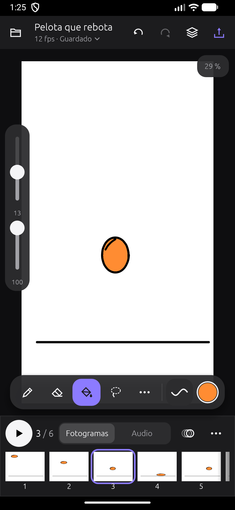
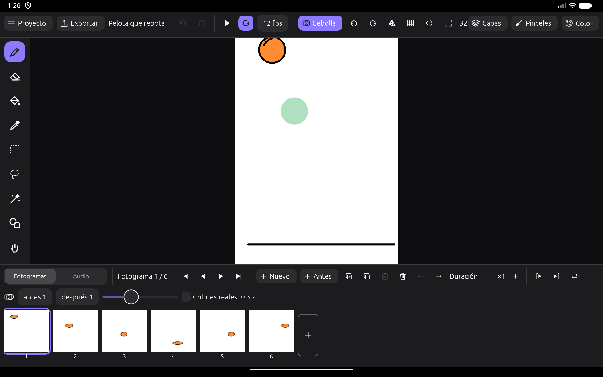

<p align="center">
  
</p>

<h1 align="center">Trazo</h1>

<p align="center">
  <b>Animación cuadro a cuadro y dibujo para Android, tablets y PC.</b><br>
  Libre, sin anuncios, sin conexión y escrita 100&nbsp;% en Rust.
</p>

<p align="center">
  
  
  
  
</p>

<p align="center">
  
  
  
  
  
</p>

Trazo es una app para animar a mano, fotograma a fotograma, al estilo de FlipaClip o ibis Paint. Está pensada
primero para el teléfono, se adapta a tablets y también funciona en el ordenador. Todo ocurre en tu dispositivo:
no hay cuentas, anuncios ni muros de pago.

## Qué puedes hacer

**Dibujar**
- 24 pinceles: lápices, tinta, rotuladores, pintura, aerógrafo y texturas. Cada uno tiene una vista
  previa de su trazo y responde a la presión.
- Pinceles propios: crea copias, ajústalas e importa o exporta pinceles `.animbrush`. También puedes usar
  imágenes PNG como punta.
- Estabilizador, simetría, figuras (línea, rectángulo y elipse), relleno que cierra huecos, cuentagotas,
  selección rectangular, lazo y varita mágica para mover, escalar y girar.
- Capas con opacidad, 5 modos de fusión, máscara de recorte, bloqueo de transparencia y capas de fondo fijas.

**Animar**
- Línea de tiempo con miniaturas y papel cebolla configurable.
- Duración por dibujo («a doses», «a treses»), rango de reproducción, bucle e ida y vuelta.
- Reordena arrastrando, copia y pega fotogramas, y selecciona varios a la vez.
- **Rotoscopia:** importa un video o un GIF como capa de referencia, con tinte gris o azul para calcar. La capa
  crea los fotogramas por ti y no sale en el resultado exportado.

**Sonido**
- Varias pistas de audio que se mezclan; admite WAV, MP3, OGG, FLAC y M4A.
- Graba voz en off sobre la animación, con cuenta atrás y pre-roll.
- Recorta, divide, normaliza y añade fundidos.
- Lip-sync con scrub, marcadores y fonemas.

**Exportar y compartir**
- Atajos para TikTok / Reels (9:16), Instagram (4:5), cuadrado, YouTube (16:9) y GIF para WhatsApp.
- Formatos:
  - MP4 con H.264 y AAC, usando el codificador del teléfono.
  - GIF, PNG y secuencia PNG.
  - AVI y WAV.
- Comparte directamente desde la app.

**Interfaz**
- Diseñada para el pulgar en teléfonos verticales, con un riel lateral en horizontal y paneles fijos en tablet
  y escritorio.
- Tema oscuro neutro para que los colores de tu dibujo se vean fieles.
- Deshacer con dos dedos y rehacer con tres.

<p align="center">
  
  
</p>

## Instalar

Por ahora no hay versión en Play Store: compila el APK con los pasos de abajo o descárgalo desde
[Releases](../../releases) cuando haya una publicada. Necesitas Android 10 o superior.

## Compilar

Requisitos: [Rust](https://rustup.rs) estable.

### Escritorio (Windows, macOS, Linux)

```bash
cargo run --release -p trazo_app
```

### Android

Necesitas Android Studio (o el SDK de Android), el NDK y [`cargo-apk`](https://crates.io/crates/cargo-apk):

```bash
cargo install cargo-apk
rustup target add aarch64-linux-android x86_64-linux-android
```

Para un teléfono o tablet real (arm64):

```bash
cargo apk build -p trazo_app --lib --target aarch64-linux-android --release
adb install -r target/release/apk/Trazo.apk
```

`scripts/android.sh` compila para el emulador x86_64, lo arranca si hace falta (AVD `Animate_Tablet`, o el
que indiques con `AVD=...`), instala la app y la abre.

### Pruebas

```bash
cargo test --workspace
```

## Cómo está hecho

| Crate | Qué contiene |
|---|---|
| [`crates/trazo_core`](crates/trazo_core) | El motor, sin interfaz: lienzo por mosaicos, pinceles y trazos, relleno, capas y fotogramas, deshacer y rehacer, mezcla de audio, capas de video, guardado (`.anim`, un zip con PNG y JSON) y exportadores. Se puede probar por separado. |
| [`crates/trazo_app`](crates/trazo_app) | La interfaz con [egui](https://github.com/emilk/egui) / eframe: distribuciones de teléfono, horizontal y tablet; audio en tiempo real con cpal; y en Android, MediaCodec y MediaStore a través del NDK. |

- **Todo en Rust:** también la parte de Android (JNI y NDK), sin código Java ni Kotlin.
- **Iconos vectoriales** propios, para que se vean igual en cualquier dispositivo.
- **Diseño:** en la carpeta [`assets/icon`](assets/icon) están el icono en todos los tamaños y el script que lo genera.

## Atajos de teclado

| | |
|---|---|
| B · E · G · I | pincel · borrador · relleno · cuentagotas |
| S · L · W · U · H | selección · lazo · varita · figuras · mano |
| `,` `.` · N · O | fotograma anterior / siguiente · nuevo fotograma · papel cebolla |
| `[` `]` · R · M | tamaño del pincel · girar lienzo · voltear vista |
| Enter · K | reproducir · marcador de audio |
| Ctrl+Z / Ctrl+Y · Ctrl+S · Ctrl+E | deshacer / rehacer · guardar · exportar |

## Hoja de ruta

Ya está hecho: dibujo y animación completos, audio con voz en off, exportación para redes, importación de video
para rotoscopia y la interfaz adaptable. Próximos pasos (detalle en [TODO.md](TODO.md)):

- Mover y recortar el clip de video arrastrándolo en la línea de tiempo, y tiradores en el lienzo.
- Exportar MP4 en escritorio y en segundo plano en Android.
- Marca de agua opcional y hoja de sprites.

## Contribuir

Se agradecen issues y pull requests. Antes de enviar un cambio, ejecuta `cargo test --workspace` y
`cargo clippy --workspace`. La interfaz está en español; si quieres ayudar a traducirla, abre un issue.

## Licencia

Trazo es software libre bajo la [GNU GPL v3.0 o posterior](LICENSE): puedes usarlo, estudiarlo, modificarlo y
compartirlo. Si distribuyes una versión modificada, también debe ser libre.

---

*In English:* **Trazo** is a free, open-source frame-by-frame animation and drawing app (FlipaClip / ibis Paint style)
for Android phones, tablets and desktop, written entirely in Rust with egui. It offers layers, 24 brushes, onion skin,
audio tracks with voice-over and lip-sync, video rotoscoping, and export to MP4, GIF and PNG for social media.
GPL-3.0 licensed.
