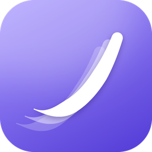
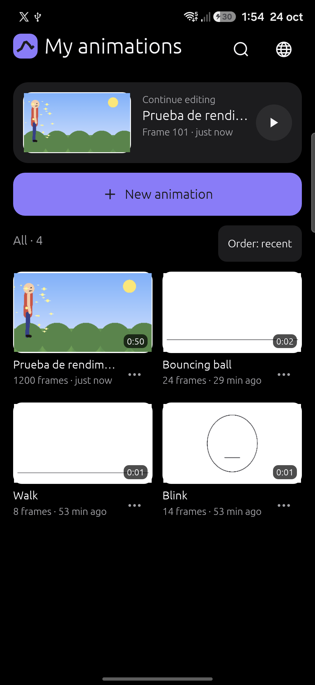
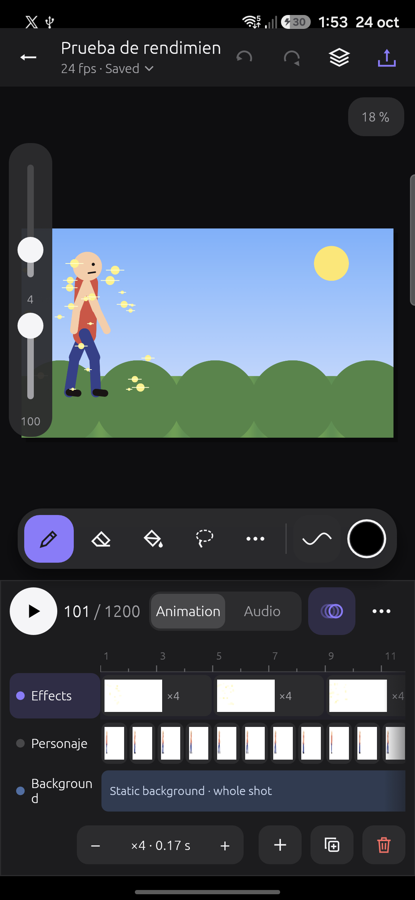
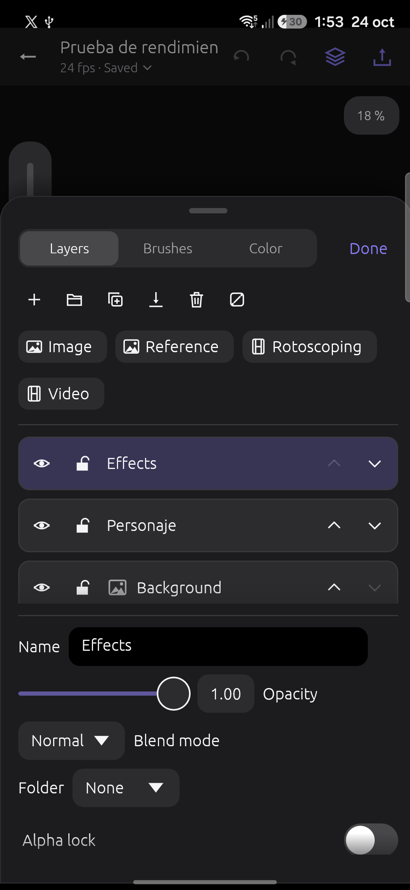
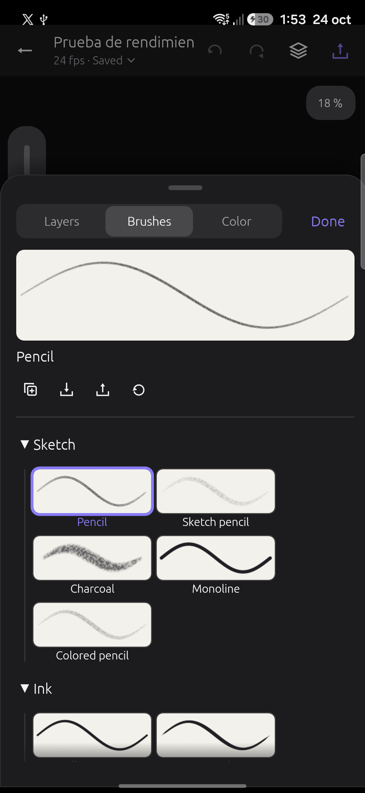
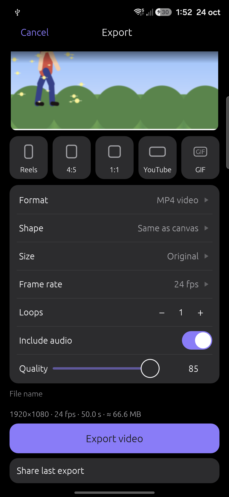
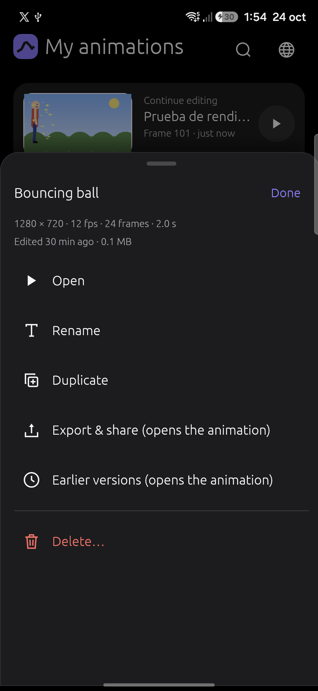
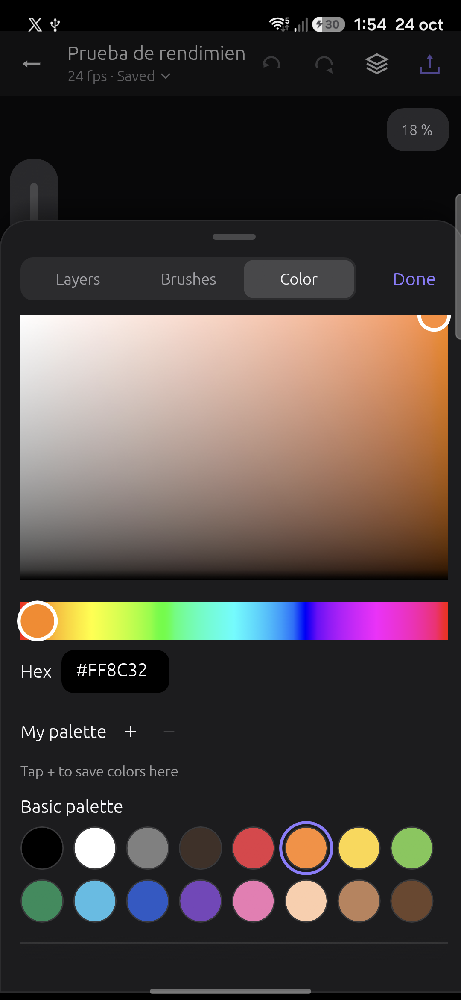
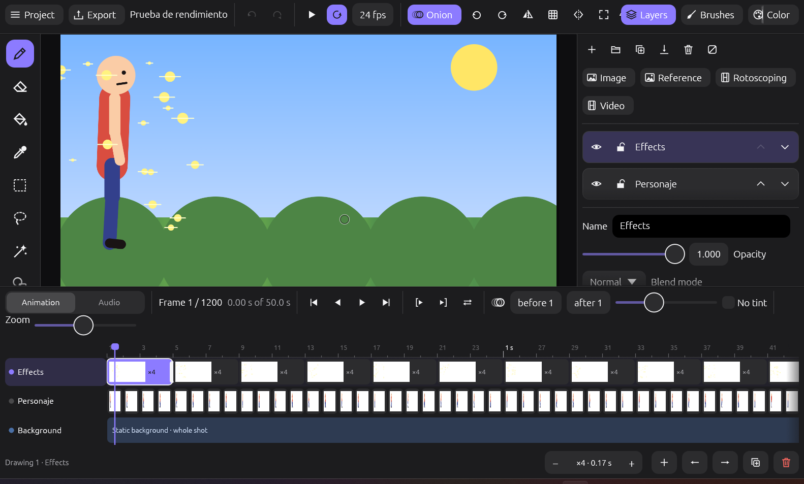

<p align="center">
  
</p>

<h1 align="center">Trazo</h1>

<p align="center">
  <b>Frame-by-frame animation and drawing for Android, tablets and PC.</b><br>
  Free, ad-free, offline and written 100&nbsp;% in Rust.
</p>

<p align="center">
  
  
  
  
</p>

<p align="center">
  
  
  
  
  
</p>

Trazo is an app for hand-drawn, frame-by-frame animation, in the spirit of FlipaClip and ibis Paint. It is
designed for phones first, adapts to tablets and also runs on desktop. Everything happens on your device:
no accounts, no ads, no paywalls.

## What you can do

**Your animations**
- Trazo opens on a gallery of your animations, each with a picture of its first frame and its length.
- *Continue editing* takes you back to the exact frame where you left off.
- Search, sort by date or name, and rename, duplicate, export or delete from each animation's menu.
- Earlier versions: a copy is kept every 10 minutes, so you can go back if something goes wrong.
- Three examples to learn from: a bouncing ball, a blink and a walk cycle.

**Draw**
- 24 brushes: pencils, ink, markers, paint, airbrush and textures. Each one shows a preview of its
  stroke and responds to pressure.
- Custom brushes: duplicate and tweak them, and import or export `.animbrush` files. PNG images can be
  used as brush tips.
- Stabilizer, symmetry, shapes (line, rectangle and ellipse), gap-closing fill, eyedropper, and
  rectangle, lasso and magic-wand selection to move, scale and rotate.
- Text tool, and fill on every drawing of a layer at once.
- Layers with opacity, 5 blend modes, clipping masks, alpha lock and fixed background layers. Group
  layers in folders, and use guide layers for sketches that never show up in the export.

**Animate**
- A timeline with one track per layer, so each layer keeps its own timing. Drag the edge of a drawing
  to make it last longer or shorter; a bubble shows the length in frames and seconds. A background can
  hold for the whole shot while the character changes every two frames.
- Thumbnails, pinch-to-zoom, per-layer onion skin, playback range, loop and ping-pong.
- Reorder by dragging, copy and paste frames, and select several at once.
- **In-betweens:** generate the drawings between two frames, moving, scaling and rotating.
- **Record motion:** drag a selection while the animation plays and Trazo makes one drawing per frame.
- **Camera:** set a start and end framing with zoom and rotation; it is applied when playing and exporting.
- **Rotoscoping:** import a video or GIF as a reference layer, with a grey or blue tint for tracing. The
  layer creates the frames for you and is left out of the exported result.

**Sound**
- Several audio tracks mixed together; supports WAV, MP3, OGG, FLAC and M4A.
- Record voice-over on top of the animation, with countdown and pre-roll.
- Trim, split, normalize and add fades.
- Lip-sync with scrubbing, markers and phonemes.

**Export and share**
- Presets for TikTok / Reels (9:16), Instagram (4:5), square, YouTube (16:9) and GIF for WhatsApp.
- Formats:
  - MP4 with H.264 and AAC, using the phone's hardware encoder (and Media Foundation on Windows).
  - GIF, PNG and PNG sequence.
  - AVI and WAV.
- Share straight from the app.

**Interface**
- Built for the thumb on phones in portrait, with a side rail in landscape and docked panels on tablets
  and desktop.
- A neutral dark theme so the colors of your drawing look true.
- Two-finger tap to undo, three-finger tap to redo.
- Interface in English and Spanish: pick one the first time you open the app, change it any time from the project menu.
- **Big projects:** drawings are compressed in memory and saving only rewrites what changed. A
  1200-frame 1080p animation plays at a steady 24 fps on a mid-range phone, using about 300 MB of RAM.

<p align="center">
  
  
  
</p>

## Install

Download the latest version from [Releases](../../releases):

- **Android** (64-bit ARM phones and tablets, Android 10 or later): the `.apk` file. Allow
  "install unknown apps" when asked. Coming from 0.1.0 or 0.2.0? Since 0.3.0 the app is signed with a
  new permanent key, so uninstall the old version first (copy your animations before), then install.
- **Windows** (64-bit): the `.exe` file. It runs without installation. It is not code-signed, so
  Windows SmartScreen may show a warning.

There is no Play Store version yet. You can also build it yourself with the steps below.

## Build

Requirements: stable [Rust](https://rustup.rs).

### Desktop (Windows, macOS, Linux)

```bash
cargo run --release -p trazo_app
```

### Android

You need Android Studio (or the Android SDK), the NDK and [`cargo-apk`](https://crates.io/crates/cargo-apk):

```bash
cargo install cargo-apk
rustup target add aarch64-linux-android x86_64-linux-android
```

For a real phone or tablet (arm64):

```bash
cargo apk build -p trazo_app --lib --target aarch64-linux-android --release
adb install -r target/release/apk/Trazo.apk
```

Your own builds are signed with your debug key, so they can't update the official releases (uninstall
first). Official releases are built with `scripts/apk-release.sh`, which signs with Trazo's release key.

`scripts/android.sh` builds for the x86_64 emulator, starts it if needed (AVD `Animate_Tablet`, or the one
you pass with `AVD=...`), installs the app and opens it.

### Tests

```bash
cargo test --workspace
```

## How it's built

| Crate | Contents |
|---|---|
| [`crates/trazo_core`](crates/trazo_core) | The engine, with no UI: tiled canvas, brushes and strokes, fill, layers and frames, undo and redo, audio mixing, video layers, saving (`.anim`, a zip of PNG and JSON) and exporters. It can be tested on its own. |
| [`crates/trazo_app`](crates/trazo_app) | The interface, built with [egui](https://github.com/emilk/egui) / eframe: phone, landscape and tablet layouts; real-time audio with cpal; and on Android, MediaCodec and MediaStore through the NDK. |

- **All Rust:** the Android side too (JNI and NDK), with no Java or Kotlin code.
- **Custom vector icons**, so they look the same on every device.
- **Design:** the [`assets/icon`](assets/icon) folder holds the icon in every size and the script that generates it.

## Keyboard shortcuts

| | |
|---|---|
| B · E · G · I | brush · eraser · fill · eyedropper |
| S · L · W · U · H | selection · lasso · magic wand · shapes · hand |
| `,` `.` · N · O | previous / next frame · new drawing · onion skin |
| `[` `]` · R · M | brush size · rotate canvas · flip view |
| Enter · K | play · audio marker |
| Ctrl+Z / Ctrl+Y · Ctrl+S · Ctrl+E | undo / redo · save · export |

## Roadmap

Done: full drawing and animation, per-layer timeline, audio with voice-over, export for social media, video
import for rotoscoping, the adaptive interface, the home screen, in-betweens, camera and support for big projects. Next steps (details in [TODO.md](TODO.md), in Spanish):

- Move and trim the video clip by dragging it on the timeline, and on-canvas handles.
- Move drawings by dragging them, and select several drawings at once.
- MP4 export on macOS and Linux, and background export on Android.
- Scenes, to split long animations into parts.
- Google Play release.
- Optional watermark and sprite sheets.

## Contributing

Issues and pull requests are welcome. Before sending a change, run `cargo test --workspace` and
`cargo clippy --workspace`.

**Translations:** the interface is in Spanish and English, chosen the first time the app opens (and later from the project menu). To add a language, copy
[`crates/trazo_app/src/i18n/en.rs`](crates/trazo_app/src/i18n/en.rs), translate the right-hand column and add the language to `Lang` in
[`i18n.rs`](crates/trazo_app/src/i18n.rs); `cargo test` tells you if a string is missing.

## License

Trazo is free software under the [GNU GPL v3.0 or later](LICENSE): you can use, study, modify and share it.
If you distribute a modified version, it must be free as well.

---

*En español:* **Trazo** es una app libre y gratuita para animar a mano, cuadro a cuadro, al estilo de FlipaClip o
ibis Paint, para teléfonos Android, tablets y PC, escrita en Rust. Abre en una galería con tus animaciones y te
deja seguir donde lo dejaste. Tiene capas con su propio ritmo, 24 pinceles, papel cebolla, dibujos intermedios,
cámara, pistas de audio con voz en off y lip-sync, rotoscopia con video y exportación a MP4, GIF y PNG para redes.
Aguanta proyectos grandes incluso en teléfonos de gama media. La interfaz está en español e inglés. Licencia GPL-3.0.
